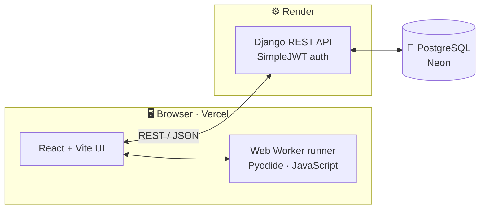
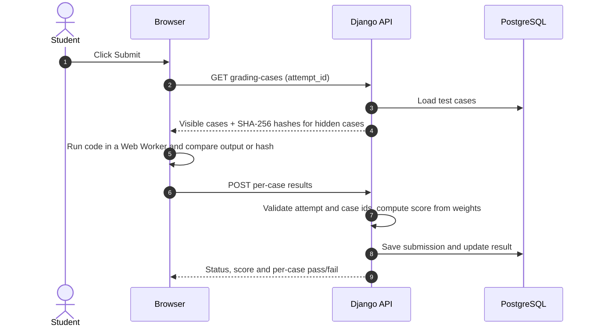
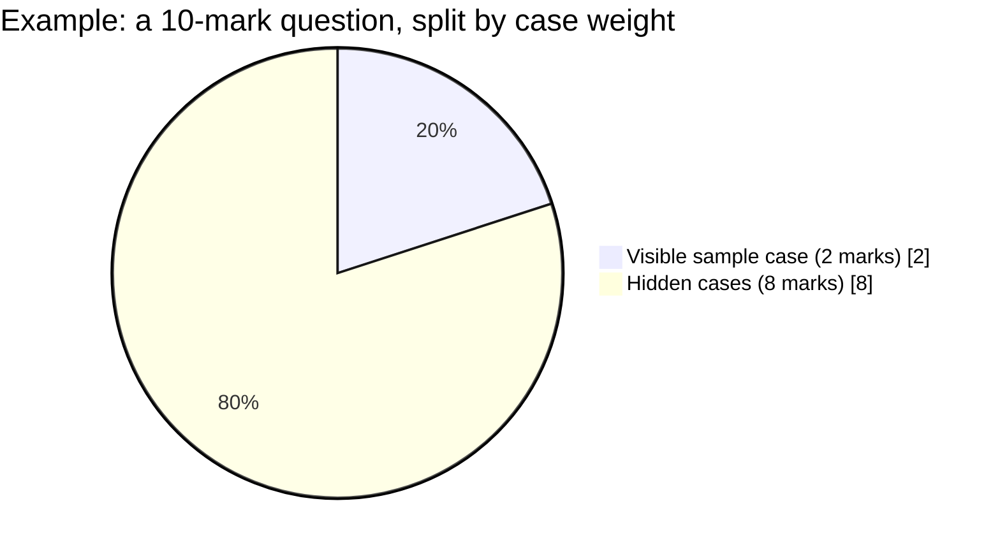
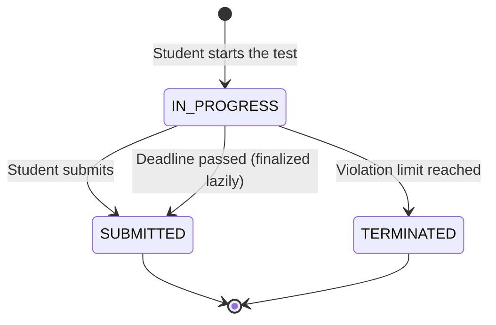
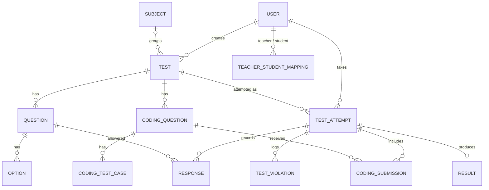

<div align="center">

# 🎓 DTEP — Digital Test & Evaluation Portal

**Run college assessments online: MCQ, descriptive and auto-graded coding questions, with anti-cheating enforced on the server.**

[](https://dtep-portal.vercel.app/)
[](API_CONTRACT.md)


<sub>⏳ The backend runs on a free Render instance, so the first request after a quiet period can take 30–60 seconds.</sub>

</div>

---

## ✨ Highlights

| | |
|---|---|
| 👥 **Three roles** | Admin, Teacher (shown as "Evaluator" on the login screen) and Student, enforced on the backend. Accounts are created by the admin; there is no self-registration. |
| 📝 **Three question types** | MCQ and coding are scored automatically. Descriptive answers are graded by the teacher. |
| 💻 **Coding questions** | Monaco editor, Python and JavaScript, visible samples, hidden test cases, Run and Submit, and teacher review of submitted code. |
| 🛡️ **Anti-cheating** | Violations, the deadline and termination are decided by the **server**, not the browser. |
| ⏱️ **Reliable attempts** | Timed attempts with autosave, resume after refresh and a server-anchored timer. |
| 💸 **Zero hosting cost** | Vercel, Render and Neon free tiers. No code-execution service. |

## 📸 Screenshots

<!--
Add 3-4 images (no passwords or real student data) under docs/screenshots/ and uncomment:

<p align="center">
  
  
</p>
<p align="center">
  
  
</p>
-->

_Screenshots coming soon._

## 🧭 Roles at a glance

| Capability | 🛠️ Admin | 👩‍🏫 Teacher | 🎒 Student |
|---|:---:|:---:|:---:|
| Create teacher and student accounts, map students to teachers | ✅ | | |
| Create, edit and publish tests (MCQ, descriptive, coding) | | ✅ | |
| Grade descriptive answers and review submitted code | | ✅ | |
| See violation timeline and end reason per attempt | | ✅ | |
| Take timed tests, run and submit code | | | ✅ |
| View results and per-case coding feedback | | ✅ | ✅ |

## 🏗️ Architecture



## 💻 How coding questions work

Student code **never runs on the server**. Python runs in the browser through Pyodide and JavaScript runs in a Web Worker, so the feature needs no code-execution service and costs nothing to host.



- 🔒 **Hidden cases stay hidden.** The browser receives only the input and a SHA-256 hash of the normalized expected output, never the answer itself.
- 🧮 **Scoring happens on the server:**

```text
score = max_marks × (sum of marks of passed cases) ÷ (sum of marks of all cases)
```



- 📐 Output normalization (only the space character is stripped at line ends) and shared test vectors are documented in [`API_CONTRACT.md`](API_CONTRACT.md).

## 🛡️ Anti-cheating

The browser only **reports** events. The server stores them, counts them and decides when to terminate.

| Event | Counts toward the limit? | Notes |
|---|:---:|---|
| 🪟 Tab switch or window blur | ✅ | One count per "away episode" |
| 🖥️ Fullscreen exit | ✅ | Blocking overlay until the student re-enters |
| ✂️ Copy, paste, right-click | ❌ | Blocked and logged; pasting inside the code editor from the same editor is allowed |



- The limit is `MAX_TEST_VIOLATIONS` (default 3). At the limit the server terminates the attempt and creates the result.
- Writes to a terminated, submitted or expired attempt are rejected.
- The timer follows the server's clock. Expired attempts are finalized on the next request, so no background worker is needed.

## 🗄️ Data model



## 🛠️ Tech stack

| Layer | Technology |
|---|---|
| Frontend |    React Router · Axios · Monaco Editor · Pyodide (CDN) |
| Backend |   Django REST Framework · SimpleJWT · WhiteNoise · Gunicorn |
| Database |  Neon (serverless Postgres with branching) |
| Hosting |    |

## 🧠 Design decisions

| Decision | Why |
|---|---|
| Run code in the browser | The public Piston API is no longer free, and Judge0's hosted free tier is small and needs a card. Browser execution is free, has no rate limit and never runs student code on the server. |
| Hash hidden test outputs | Hidden answers never reach the browser, so the Network tab does not reveal them. |
| Server-side counting and deadlines | A client-side counter resets on refresh and can be tampered with. The server's count is the single source of truth. |
| Lazy finalization instead of a worker | Free hosting has no background worker. Expired attempts are finalized when they are next read or written. |
| Separate Neon branches | Local work and production never share data, and migrations can be rehearsed on a branch first. |

## ⚠️ Limitations (honest ones)

- **Coding grading is reported by the browser and is trust-based.** A determined student could send fake per-case results through the API. This suits internal college tests, not high-stakes exams. Each submission records `graded_by = "browser"`, so a server-side judge can replace it later.
- Only **Python and JavaScript** are supported for coding questions.
- Anti-cheating is a **deterrent plus server-side enforcement**. It cannot stop a second device or phone, and there is no camera, microphone, recording or face detection.
- Tests are meant to be taken on a **desktop browser**.
- When creating a test, add at least one MCQ first; then add coding questions from **Tests → Details → Coding questions**.
- Free-tier hosting: Render sleeps when idle and Neon scales to zero.

## 🗺️ Roadmap

- [x] Role-based auth with JWT
- [x] MCQ and descriptive tests with autosave and resume
- [x] Browser-executed coding questions with hidden test cases
- [x] Server-enforced anti-cheating and server-anchored timer
- [x] Deployed on Vercel, Render and Neon
- [ ] "Coding test" option in the test creation form (coding-only tests)
- [ ] Server-side re-verification or a self-hosted judge, and C++ / Java
- [ ] Load testing and more Gunicorn workers
- [ ] Structured logging and a "reopen attempt" action for teachers

## 🚀 Local development

<details>
<summary><b>Click to expand the setup guide</b></summary>

### Prerequisites

- Python 3.11 or 3.12
- Node.js 18+ and npm
- Git
- A PostgreSQL database (a free Neon branch works well), or SQLite for a quick start

### 1. Clone

```bash
git clone https://github.com/mahakcodes/dtep-portal.git
cd dtep-portal
```

### 2. Backend

```bash
python3 -m venv .venv
source .venv/bin/activate        # Windows: .venv\Scripts\activate
pip install -r requirements.txt
```

Create a `.env` file in the repository root (never commit it):

```dotenv
DJANGO_SECRET_KEY=<a long random string>
DATABASE_URL=<your PostgreSQL connection string, or sqlite:///db.sqlite3 for a quick start>
DEBUG=True
```

Then:

```bash
python manage.py migrate
python manage.py createsuperuser   # then set this user's role to ADMIN
python manage.py runserver
```

The backend runs at http://127.0.0.1:8000/.

### 3. Frontend

In a second terminal:

```bash
cd frontend
npm ci
npm run dev
```

The frontend runs at http://localhost:5173/ and calls `http://127.0.0.1:8000` by default, so no extra configuration is needed locally. Use `localhost:5173` in the browser, because the backend's CORS allow-list contains that origin.

</details>

## 🔧 Environment variables

| Variable | Where | Purpose |
| --- | --- | --- |
| `DJANGO_SECRET_KEY` | Backend | Django secret key (required) |
| `DATABASE_URL` | Backend | Database connection string (required) |
| `DEBUG` | Backend | `True` locally, `False` in production |
| `CORS_ALLOWED_ORIGINS` | Backend | Comma-separated frontend origins allowed in production (no trailing slash) |
| `MAX_TEST_VIOLATIONS` | Backend | Violations allowed before an attempt is terminated (default 3) |
| `VITE_API_BASE_URL` | Frontend | Backend host without `/api` (default `http://127.0.0.1:8000`) |

`RENDER_EXTERNAL_HOSTNAME` is set automatically by Render.

## 🧪 Tests

```bash
# Backend (uses a throwaway SQLite database)
DATABASE_URL=sqlite:///test_local.sqlite3 python manage.py test

# Frontend
cd frontend
npm test
npm run build
```

## ☁️ Deployment

- **Database:** Neon PostgreSQL. Use a separate Neon branch for development so local work never touches production data.
- **Backend (Render):** build command `pip install -r requirements.txt && python manage.py collectstatic --noinput && python manage.py migrate`, start command `gunicorn config.wsgi:application`. Set `DJANGO_SECRET_KEY`, `DATABASE_URL`, `DEBUG=False`, `PYTHON_VERSION` and `CORS_ALLOWED_ORIGINS` (the Vercel URL).
- **Frontend (Vercel):** root directory `frontend`, with `VITE_API_BASE_URL` set to the Render URL. This variable is read at build time, so redeploy after changing it.
- The `main` branch deploys automatically. Work happens on feature branches and is merged through pull requests.

## 📁 Repository structure

```text
dtep-portal/
├── apps/          # Django apps: users, tests, evaluations, results, coding
├── config/        # Django project settings and URLs
├── frontend/      # React + Vite app
├── API_CONTRACT.md
├── manage.py
├── requirements.txt
└── README.md
```

## 📘 API documentation

See [`API_CONTRACT.md`](API_CONTRACT.md) for endpoints, request and response shapes, and the coding and anti-cheating rules.


<div align="center">
<sub>Built with Django, React and a lot of free-tier engineering.</sub>
</div>
